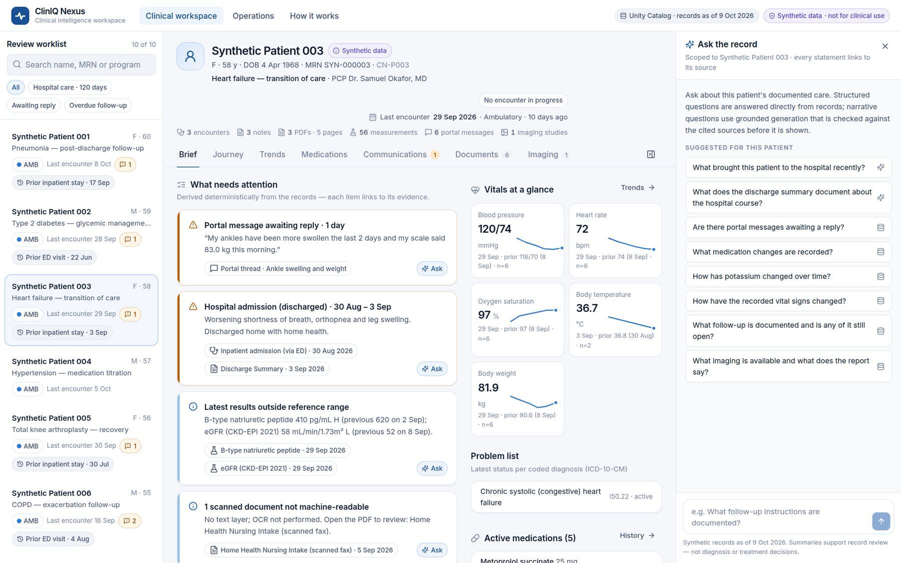
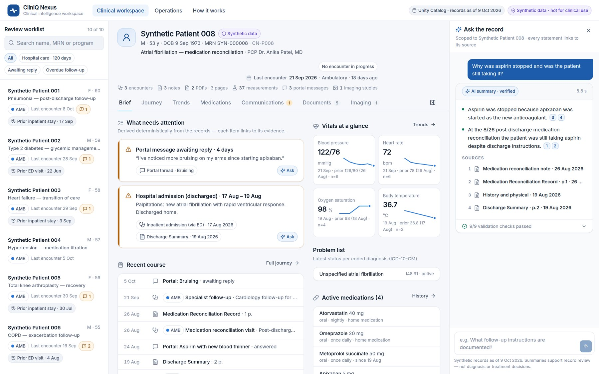
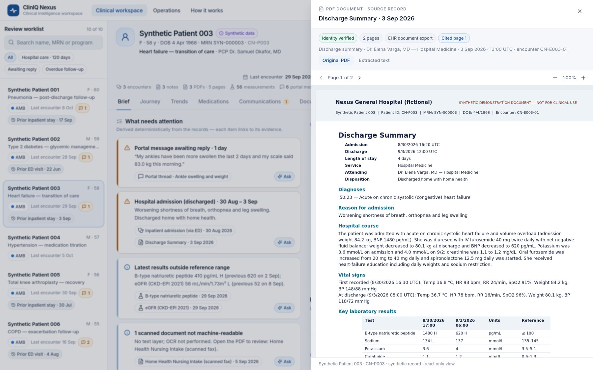
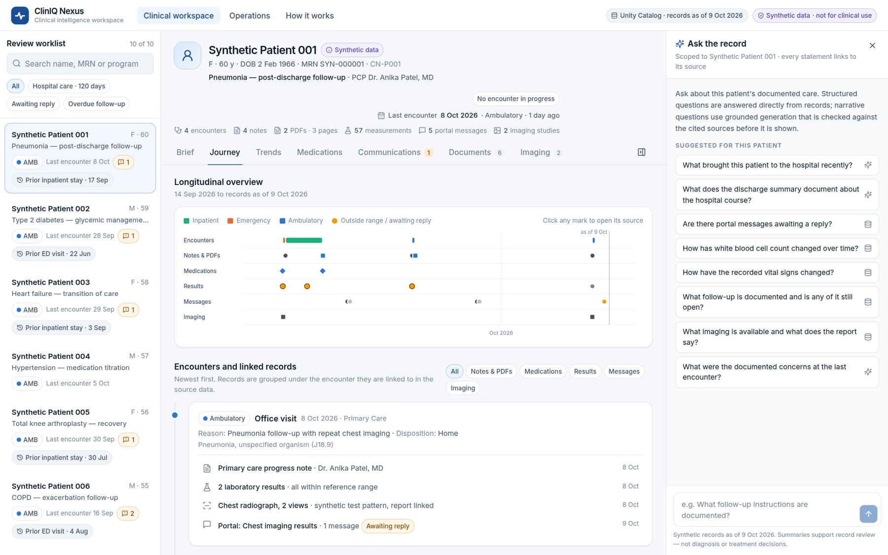
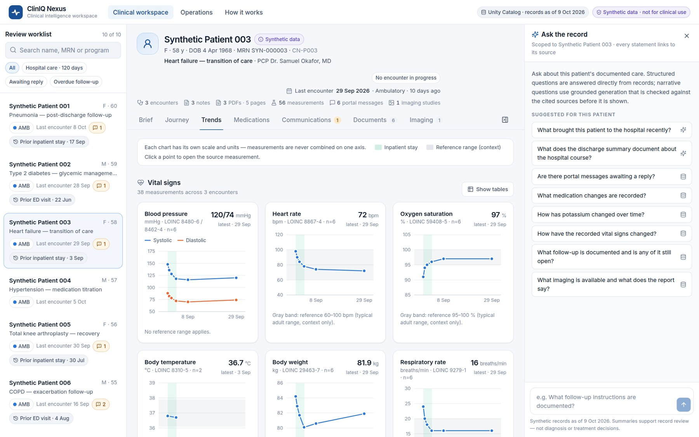
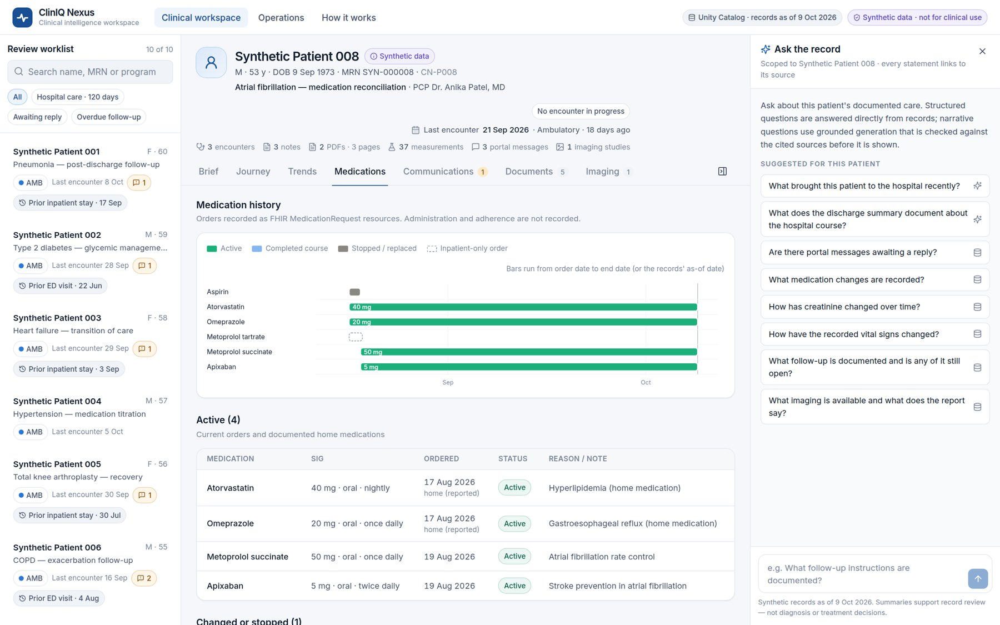
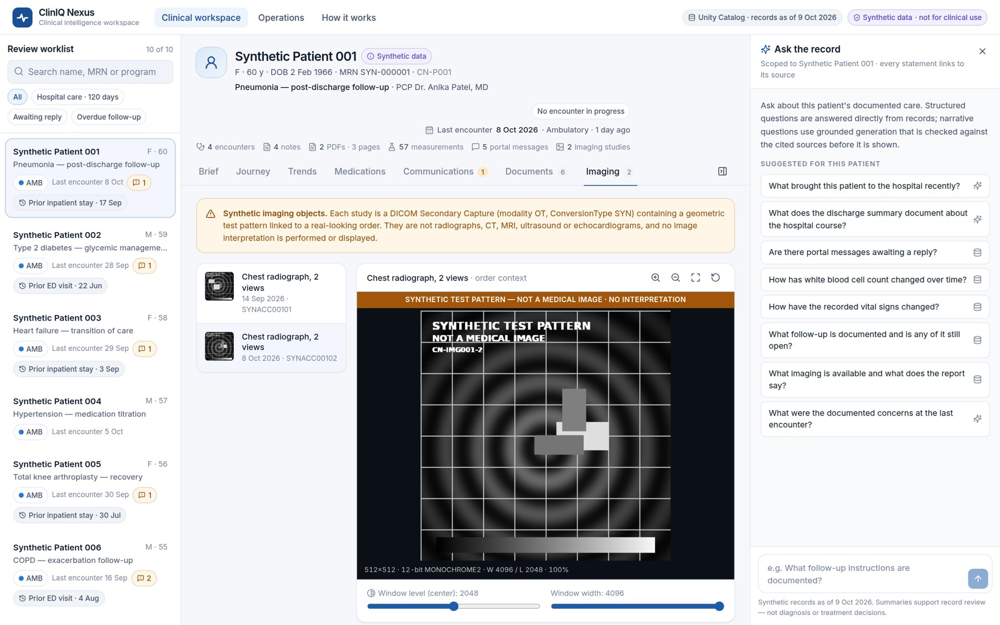
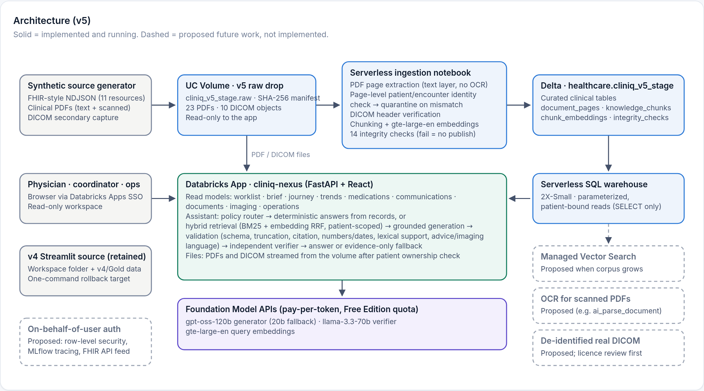
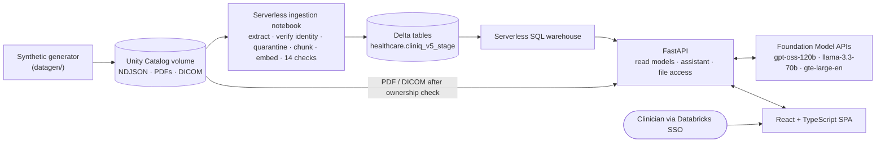

# ClinIQ Nexus

**Enterprise healthcare AI and multimodal clinical intelligence on a governed Databricks lakehouse.**

ClinIQ Nexus is a physician-centered workspace for pre-visit and post-discharge chart review. It combines in one patient-scoped view:

- FHIR-style structured records;
- clinical notes;
- PDF clinical documents;
- patient-portal communication;
- DICOM imaging.

It answers one question with evidence attached: ***What has happened with this patient, what matters, and where is the evidence?***

> **Synthetic demonstration only.** Every patient, clinician and organization is fictional. ClinIQ Nexus is not a production clinical system, an EHR integration, a diagnostic tool or HIPAA-certified software. Imaging objects are synthetic DICOM test patterns and are never interpreted.



## The problem

Before a follow-up visit or after a discharge, a physician has to reconstruct the patient's story. The pieces are spread across:

- encounters and diagnoses;
- notes;
- vital signs and laboratory results;
- medication orders;
- discharge summaries and consult letters (often PDFs, sometimes scanned faxes);
- portal messages;
- imaging reports.

The work is slow and easy to get wrong, and summaries written from memory are hard to verify.

## Users

| User | Supported tasks (review, not decisions) |
|---|---|
| **Physician / clinical reviewer** (primary) | See what needs attention; review the longitudinal journey, trends and medication history; read notes and PDFs; ask cited questions; see what is *not* documented |
| **Care coordinator** | Find portal threads awaiting reply or routed without completion; check documented follow-up and its status |
| **Clinical operations / IT leader** | Encounter mix, documentation coverage, communication patterns, imaging linkage, and live data-integrity checks |

## Features

- **Physician brief:** a deterministic "what needs attention" list, including:
  - recent hospital care (labelled *discharged*);
  - messages awaiting a reply;
  - medication changes;
  - results outside reference ranges;
  - overdue follow-up;
  - documents that can't be searched.

  Every item opens its source record.
- **Longitudinal journey:** swimlanes for encounters, notes and PDFs, medications, results, messages and imaging, plus records grouped by encounter.
- **Clinical trends:** one chart per measure, each with its own units, LOINC codes, reference bands and inpatient shading. Sparse series are labelled as such, and every chart has a table view.
- **Medication history:** a timeline of FHIR-style orders showing dose-change chains, stopped and completed courses, and inpatient-only orders.
- **Care coordination:** threads marked awaiting reply, routed or answered, with waiting and first-response times.
- **PDF document intelligence:**
  - page-level text extraction;
  - patient and encounter identity verification on every page;
  - quarantine of misfiled documents;
  - scanned faxes flagged as not searchable (no pretend OCR);
  - AI citations that open the PDF on the cited page.
- **DICOM imaging:** a viewer with window/level, zoom and pan, file-header metadata, and order and report linkage, with a persistent "synthetic test pattern — not a medical image" watermark.
- **Ask the record:** a patient-scoped assistant with deterministic answers, grounded generation, inspectable citations and evidence-only fallback.
- **Operations and architecture:** coverage and integrity dashboards, and an in-app architecture and AI-safety page.

| Cited AI answer | PDF opened on the cited page |
|---|---|
|  |  |
| **Longitudinal journey** | **Clinical trends** |
|  |  |
| **Medication history** | **Imaging (synthetic test pattern)** |
|  |  |

## Architecture





The design separates implemented components from proposed future work. Everything runs on **Databricks Free Edition** with no additional paid infrastructure. Details: [docs/02-architecture.md](docs/02-architecture.md).

## AI safety approach

1. **Patient isolation.** Every read binds the patient ID as a SQL parameter and re-checks each row; files are served only after an ownership check. Retrieval candidates come only from the selected patient.
2. **Policy first.** Questions about other patients, requests for diagnosis, treatment or dosing recommendations, and requests to read images are handled before any retrieval or model call.
3. **Deterministic before generative.** Medications, vitals, labs, messages, follow-up, imaging inventory and information gaps are answered directly from records.
4. **Grounded generation.** Hybrid retrieval (BM25 plus embeddings, fused with reciprocal-rank fusion) returns sources with labels and page numbers. The model must return structured claims that are either *documented* (cited) or *not documented*.
5. **Fail-closed validation.** A citation ID existing doesn't count as verification. Every claim must pass all of:
   - schema and truncation checks;
   - known citations;
   - numbers and dates present in the cited text;
   - lexical support;
   - no advice or imaging-finding language absent from the sources;
   - an independent verifier model.

   If any check fails, the user sees evidence only, with the reason stated.
6. **Unknown ≠ negative.** Missing information is reported as "not documented", never as a negative finding.

## Synthetic data

The v5 dataset covers ten fictional patients with clinically consistent storylines:

- pneumonia;
- diabetes;
- heart-failure transition of care;
- hypertension;
- knee arthroplasty;
- COPD;
- CKD;
- atrial fibrillation with a medication-reconciliation discrepancy;
- iron-deficiency anemia with a stalled referral;
- lipids.

Notes, PDFs and imaging reports are generated *from* the structured facts, so values stay consistent across sources. The dataset deliberately includes unanswered messages, scanned faxes and one misfiled PDF. See [docs/05-data-dictionary.md](docs/05-data-dictionary.md).

## Testing and validation

| Validation | Result |
|---|---|
| Automated tests (`pytest tests`) | **166 passed**: integrity, isolation, routing, structured answers, validator failure modes, fallbacks, API |
| Cross-source clinical consistency audit | **14/14**: identities and ages, chronology, labs and units, medication chains, PDF tables, DICOM headers, brief values |
| Live AI evaluation (39 questions, Unity Catalog + Foundation Model APIs) | Isolation **91/91** · unresolved citations **0** · verified narrative answers **18/18** · unsupported questions "not documented" **6/6** · policy routing **9/9** · imaging findings **0** · median **6.2 s** |
| End-to-end acceptance on the deployed app | **24/24** |
| Security | Secret scan clean · `bandit` reviewed · `npm audit` 0 · `pip-audit` 1 non-applicable residual (documented) |

Details: [docs/04-testing-and-evaluation.md](docs/04-testing-and-evaluation.md) · [docs/acceptance/](docs/acceptance/).

## Deployment

ClinIQ Nexus is deployed as a Databricks App. Configuration comes from `app/app.yaml` and app resources, and credentials are injected by the platform. The app's service principal has read-only, least-privilege access. A scripted deploy builds the frontend, uploads the bundle, applies grants, deploys and smoke-tests. Rollback redeploys the previous version's source folder with one command.

```bash
python -m venv .venv && .venv/bin/pip install -r requirements-dev.txt
(cd app/frontend && npm ci && npm run build)
.venv/bin/python datagen/generate.py && .venv/bin/python pipeline/cliniq_pipeline.py   # synthetic data + local tables
.venv/bin/python -m pytest -q tests
tools/deploy.sh --profile <databricks-cli-profile> --warehouse <warehouse-id>        # candidate app
```

Databricks Apps require workspace sign-in, so the app is not publicly accessible. For public audiences, use the screenshots and the recorded walkthrough in [docs/portfolio/](docs/portfolio/). The full procedure, permissions, quota handling and rollback are in [docs/03-deployment-and-rollback.md](docs/03-deployment-and-rollback.md).

## Repository layout

```
app/backend/      FastAPI: allowlisted data access, clinical read models, file access, assistant/
app/frontend/     React + TypeScript + Vite + Tailwind single-page app
app/app.yaml      Databricks Apps manifest (no secrets)
datagen/          Synthetic scenarios, record builder, PDF and DICOM renderers
pipeline/         Ingestion library (shared by local runs and the Databricks notebook)
notebooks/        Databricks ingestion notebook
data/v5/          Generated synthetic raw drop + locally processed tables
tests/            Offline pytest suite
eval/             Live evaluation harness and latest results
tools/            Build, deploy, smoke/acceptance tests, audit, screenshots, demo video
docs/             Product concept, architecture, deployment, testing, data dictionary, acceptance, portfolio
```

## Limitations

**Synthetic data**

- **Fictional records.** All records are synthetic and were authored for demonstration. The ten storylines, notes, documents and messages are designed to be internally consistent, but they **have not been reviewed by clinicians** and are not a source of clinical guidance.
- **Reference ranges** are typical adult ranges used only to label demonstration values.
- **Illustrative metrics.** Ten patients is too few for operational metrics to be statistically meaningful.
- **Synthetic imaging.** Imaging objects are geometric DICOM test patterns; no image is real and none is interpreted.

**Implemented capability boundaries**

- Scanned PDFs are flagged but not OCR'd, so their content is viewable but not searchable or citable.
- Retrieval embeddings are stored per chunk and compared in-app; managed Vector Search is not used.
- AI answers are checked automatically (citations, numbers and dates, lexical support, policy language, second-model verification). These checks reduce but do not eliminate the need for human review. Model outputs can vary between runs, and the evaluation figures describe the run documented in `eval/results/latest.json`.
- The app runs on Databricks Free Edition. It requires workspace sign-in (no anonymous access), apps stop after 24 hours, and pay-per-token endpoints are rate-limited.
- There is no EHR integration, no user-level authorization model beyond workspace access, and no write-back. The app is read-only.

**Proposed future work (not implemented)**

- On-behalf-of-user authorization with row-level security.
- OCR with ground-truth evaluation.
- MLflow tracing.
- Managed Vector Search.
- A licensed de-identified imaging library ([docs/06-public-dicom-options.md](docs/06-public-dicom-options.md)).

## Documentation

[Product concept](docs/01-phase1-product-concept.md) · [Architecture](docs/02-architecture.md) · [Deployment and rollback](docs/03-deployment-and-rollback.md) · [Testing and evaluation](docs/04-testing-and-evaluation.md) · [Data dictionary](docs/05-data-dictionary.md) · [Public DICOM options](docs/06-public-dicom-options.md) · [Final acceptance report](docs/acceptance/final-acceptance-report.md) · [Security audit](docs/acceptance/security-audit.md) · [Case study](docs/portfolio/technical-case-study.md)

## License

Released under the [MIT License](LICENSE). The synthetic dataset, documents and images in this repository are fictional and provided for demonstration only. They must not be used as clinical reference material.
