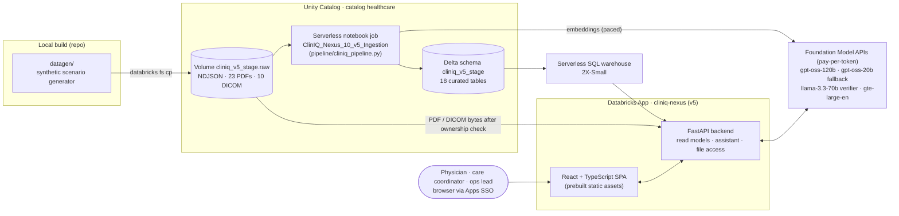
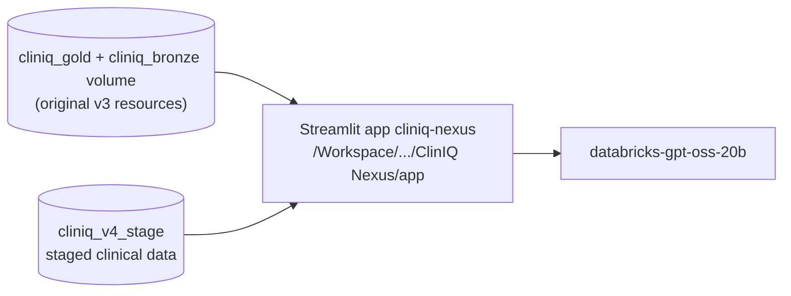

# Architecture

ClinIQ Nexus runs entirely inside a Databricks Free Edition workspace and adds no paid infrastructure. This document separates three things:

- **Implemented v5 system:** running as the primary app `cliniq-nexus`, with an identical candidate deployment `cliniq-nexus-next`.
- **v4 implementation:** retained as a tested rollback source.
- **Proposed future work:** not implemented.

## 1. Implemented: v5 (primary app `cliniq-nexus`)

### Ingestion (`pipeline/cliniq_pipeline.py`)

The same library runs as a Databricks notebook job and locally, which keeps the tests and the deployed data on one code path.

1. **Load** the FHIR-style NDJSON resources: Patient, Encounter, Condition, Observation, MedicationRequest, notes, follow-up items, Communication threads and messages, ImagingStudy, imaging reports, and the document index.
2. **Extract** PDF text page by page from the text layer using `pypdf`. Pages with no text layer are flagged `no_text_layer`. **No OCR is attempted.**
3. **Verify identity** on every text page. The printed `Patient ID` and `Encounter` must match the document index, and the indexed encounter must belong to the indexed patient. Any mismatch sends the document to `document_quarantine`, and it is never published to the app tables. The dataset contains one deliberately misfiled PDF, and it is caught by this check.
4. **Verify DICOM headers.** PatientID, AccessionNumber, Modality `OT` and ConversionType `SYN` must match the imaging catalog.
5. **Chunk** for retrieval:
   - notes, by section;
   - PDFs, per page, with page numbers kept on each chunk;
   - portal messages, one chunk each;
   - imaging reports, one chunk each.
6. **Embed** the chunks with `databricks-gte-large-en`. Calls go in batches of 8 with pacing, because Free Edition rate-limits pay-per-token queries per second.
7. **Run 14 integrity checks.** If any check fails, the notebook stops before writing tables.

### Application

| Layer | Responsibility |
|---|---|
| `datasource.py` | Reads only tables on a fixed allowlist. Patient-scoped reads bind the patient ID as a SQL parameter and re-check every returned row (`ScopeError` on violation). Results are cached with a TTL. A pool of 4 connections serves parallel reads. |
| `clinical.py` | Builds the patient bundle, the record-derived **brief** (items needing attention, each with evidence references), the worklist and the operations metrics. |
| `files.py` | Streams PDF and DICOM bytes from the volume, but only after confirming that the requested document or study belongs to the patient in the URL. Renders DICOM to PNG with window/level, and checks that the DICOM header's patient matches. |
| `assistant/router.py` | Applies policy first: other patients go to scope policy, recommendations go to advice policy, and image reading goes to imaging policy. Otherwise it routes to deterministic answers from structured data, or to grounded generation. |
| `assistant/structured.py` | Answers questions about medications, vitals, labs, messages, follow-up, imaging, encounters, documents and gaps directly from records. Every claim cites its record. |
| `assistant/retrieval.py` | Patient-scoped hybrid retrieval: BM25 combined with embedding cosine via reciprocal-rank fusion. Structured facts (encounters, medication orders) are added as retrievable sources. Falls back to lexical-only ranking if embeddings are unavailable. |
| `assistant/validate.py` | Fail-closed validation: schema, finish reason (truncated output rejected), citations present and known, numbers and dates found in the cited text, lexical support, no advice language, no imaging-finding terms. Then an independent verifier model judges each claim. |
| `assistant/service.py` | Orchestrates the steps above. Model or validation failure produces an **evidence-only** answer with the reason stated. |

### Security and data handling

- The app's service principal has `USE CATALOG healthcare`, `USE SCHEMA` + `SELECT` on `cliniq_v5_stage`, and `READ VOLUME` on `cliniq_v5_stage.raw`. It has no write privileges.
- The code contains no secrets. Databricks Apps injects the service-principal credentials, and the warehouse ID comes from the `sql-warehouse` app resource.
- Every clinical row carries `is_synthetic = true`, and the data layer rejects any row without it.
- The UI never sends messages or writes data. It is read-only by design.

## 2. v4 implementation (retained rollback source)

- Lexical retrieval over 105 v4 chunks.
- Citation-ID and truncation checks.
- Synthetic 64×64 DICOM previews.

Its workspace source folder and data have not been modified. Redeploying that folder to `cliniq-nexus` restores v4; this was rehearsed on 14 Oct 2026 (see `03-deployment-and-rollback.md`).

## 3. Proposed, not implemented

| Proposal | Why it isn't implemented now |
|---|---|
| Managed **Vector Search** index | Unnecessary at 148 chunks. Possible capacity or cost limits on Free Edition. |
| **OCR** for scanned PDFs (e.g. `ai_parse_document`) | Would change what the assistant may cite. Needs evaluation and cost review. |
| **De-identified real DICOM** studies | Requires license and provenance review first. See `06-public-dicom-options.md`. |
| On-behalf-of-user auth with row-level security | Requires an identity model beyond a single demo audience. |
| MLflow tracing and evaluation logging | The evaluation currently writes versioned JSON. MLflow would add run history. |
| Streaming FHIR API ingestion | Batch ingestion is enough for a static synthetic dataset. |
