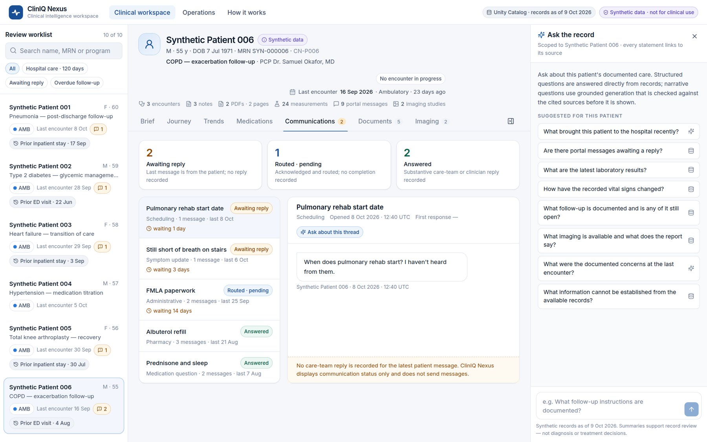

# ClinIQ Nexus: technical case study

*Enterprise healthcare AI and multimodal clinical intelligence on Databricks. Synthetic data only.*

**Role:** product design, data engineering, application architecture, AI integration, testing and deployment.
**Stack:** Databricks Free Edition (Unity Catalog, Delta Lake, managed volumes, serverless notebooks, serverless SQL warehouse, Databricks Apps, Foundation Model APIs) · Python, FastAPI · React, TypeScript, Vite, Tailwind, Recharts, pdf.js · pypdf, pydicom · pytest, Playwright.

---

## 1. Problem

Clinical information about one patient lives in many places:

- encounter history and coded diagnoses;
- notes;
- vital signs and laboratory results;
- medication orders and changes;
- PDF discharge summaries, consult letters and lab reports, some of them scanned faxes;
- patient-portal conversations;
- imaging studies and their reports.

A physician preparing for a follow-up visit, or reviewing a patient after discharge, has to rebuild the story from all of these and judge what still needs attention.

An earlier prototype (v4) proved the lakehouse plumbing, but its interface was a set of data tables over placeholder content. Its medications read "example 1", every portal thread was identical, and only systolic blood pressure was recorded.

## 2. Users and design principles

- **Primary user:** the physician doing pre-visit or post-discharge chart review.
- **Secondary users:** care coordinators (open communication loops, follow-up), and clinical operations and IT leaders (coverage, integration and data quality).

Principles:

1. **Context before detail.** Open on a brief, not a table.
2. **Every statement has a source.** Brief items, timeline events and AI claims all open the underlying record, PDF page or message.
3. **Deterministic first, generative second.** Most clinical questions (medications, vitals, labs, messages, follow-up) are answered more reliably by queries than by a model.
4. **Missing is not negative.** "Not documented" is a first-class answer.
5. **Honest boundaries.** Synthetic labelling everywhere, no image interpretation, and no recommendations.

## 3. Data: a coherent synthetic record

I rebuilt the dataset (v5) as ten fictional patients with clinically consistent storylines:

- pneumonia admission and follow-up;
- type 2 diabetes with insulin titration;
- heart-failure transition of care;
- hypertension titration;
- knee arthroplasty recovery;
- COPD exacerbation with heavy portal use;
- stage 3a CKD;
- new atrial fibrillation with an aspirin reconciliation discrepancy;
- iron-deficiency anemia with a stalled referral;
- lipid management.

Structured facts are the single source of truth. Notes, PDFs and imaging reports are rendered from them, so values match across every source type. A 14-point audit verifies this: for example, every lab value on a PDF lab report and every stated patient age is checked against the structured record.

The dataset deliberately includes the cases a real integration has to handle:

- unanswered and routed portal messages;
- two scanned faxes with no text layer;
- one misfiled PDF whose printed patient identity disagrees with the document index;
- labs drawn before a telehealth review.

| Asset | Count |
|---|---|
| Encounters (ambulatory, ED, inpatient, virtual) | 38 |
| LOINC-coded observations (vitals and labs, with UCUM units and reference ranges) | 366 |
| Medication orders (with dose-change chains and statuses) | 44 |
| Clinical notes · portal threads / messages | 38 · 27 / 49 |
| Clinical PDFs (discharge summaries, consults, lab reports, referrals, operative and therapy reports) | 23 (22 published, 1 quarantined) |
| DICOM Secondary Capture test patterns with linked reports | 10 |

## 4. Architecture

**Ingestion** runs as a serverless Databricks notebook. The same library runs locally for tests. It:

- reads the raw drop from a Unity Catalog volume;
- extracts PDF text page by page from the text layer (**no OCR**; scanned pages are flagged);
- verifies that every page's printed patient and encounter identifiers match the index, quarantining any mismatch;
- verifies DICOM headers against the imaging catalog;
- chunks text with page numbers kept;
- embeds the chunks with `gte-large-en`, in paced batches that respect Free Edition rate limits;
- writes 18 Delta tables, but only if all 14 integrity checks pass.

**The application** is one Databricks App: FastAPI serves the API and a prebuilt React/TypeScript single-page app.

- The data layer reads only allowlisted tables. Patient IDs are bound as SQL parameters, every returned row is re-checked for patient scope and synthetic status, and PDFs and DICOM files are streamed only after an ownership check.
- The app's service principal has read-only access. No secrets are stored in code.

## 5. Evidence-grounded assistant

Each question goes through the following steps:

1. **Policy routing.** Questions about other patients, requests for recommendations, and requests to read images are handled before any retrieval or model call.
2. **Deterministic answers.** Medications, vitals, labs, messages, follow-up, imaging inventory and "what cannot be established" are answered from structured records, with every claim citing its record.
3. **Hybrid retrieval for narrative questions.** BM25 and embedding similarity are fused with reciprocal-rank fusion, over the selected patient's notes, PDF pages, messages, reports and structured facts. The ranking favours recent sources for "recent" questions and the earliest sources for "initial" questions.
4. **Grounded generation.** `gpt-oss-120b` returns structured claims, each one either *documented* (with citations) or *not documented*.
5. **Fail-closed validation.** A claim is rejected if any of these checks fails:
   - the schema is valid;
   - the output was not truncated;
   - citations are present and refer to retrieved sources;
   - every number and date in the claim appears in the cited text;
   - lexical support for the claim is sufficient;
   - there is no advice language or imaging-finding vocabulary that the source lacks.

   An independent `llama-3.3-70b` verifier must then judge each claim supported. A citation ID that exists is not treated as verification.
6. **Fallback.** A rejected answer gets one fully validated retry with a fallback model. If that also fails, the user sees evidence only, with the reason stated.

Reviewing answers by hand found three subtle issues that the automated checks passed. Each was fixed and re-tested:

- a gendered pronoun for a fictional clinician;
- a presenting complaint conflated with a diagnosis;
- an "initial visit" question answered from a later encounter.

## 6. Results

| Validation | Result |
|---|---|
| Automated tests (isolation, routing, validator failure modes, fallbacks, data integrity, API) | 166 passed |
| Cross-source clinical consistency audit | 14/14 checks |
| Live AI evaluation, 39 questions | Sources from the correct patient: 91/91 · unresolved citations: 0 (14 PDF page citations) · verified narrative answers: 18/18 · unsupported questions answered "not documented": 6/6 · policy routing: 9/9 · fabricated imaging findings: 0 · median latency: 6.2 s |
| End-to-end acceptance on the deployed primary app | 24/24 checks (access control, 10 patients, 22 PDFs, 10 DICOM studies, assistant modes) |
| Release | Promoted to the primary `cliniq-nexus` app; one-command rollback to v4 rehearsed |
| Incremental infrastructure cost | $0 |

This is a prototype on synthetic data. No productivity, clinical-outcome, adoption or financial results are claimed.

## 7. Screenshot gallery

| | |
|---|---|
|  **Physician brief:** items needing attention, each linked to evidence |  **Ask the record:** verified answer with citations to notes and PDF pages |
|  **PDF viewer:** opened on the cited page, with identity verification shown |  **Longitudinal journey:** swimlanes and encounter-grouped records |
|  **Clinical trends:** per-measure scales, units, reference and inpatient bands |  **Medication history:** orders, dose changes, stopped and inpatient-only |
|  **Imaging:** DICOM window/level and metadata, synthetic and never interpreted |  **Care coordination:** awaiting-reply and routed threads |

A 1 minute 30 second captioned walkthrough is in `media/cliniq-nexus-demo.webm`.

## 8. Limitations and next steps

**Current limitations:**

- Ten synthetic patients, so operational metrics are illustrative.
- Scanned PDFs are not OCR'd.
- Retrieval embeddings are compared in-app rather than in managed Vector Search.
- Imaging is synthetic.
- The app requires Databricks sign-in.
- Automated grounding checks reduce, but do not replace, human review.

**Proposed, not implemented:**

- On-behalf-of-user authorization with row-level security.
- OCR, evaluated against ground truth, before scanned documents become citable.
- MLflow tracing and per-release evaluation tracking.
- Managed Vector Search at larger scale.
- A licensed de-identified imaging library, kept separate from the synthetic patients.
- Formal clinical-safety review and usability testing with physicians.
